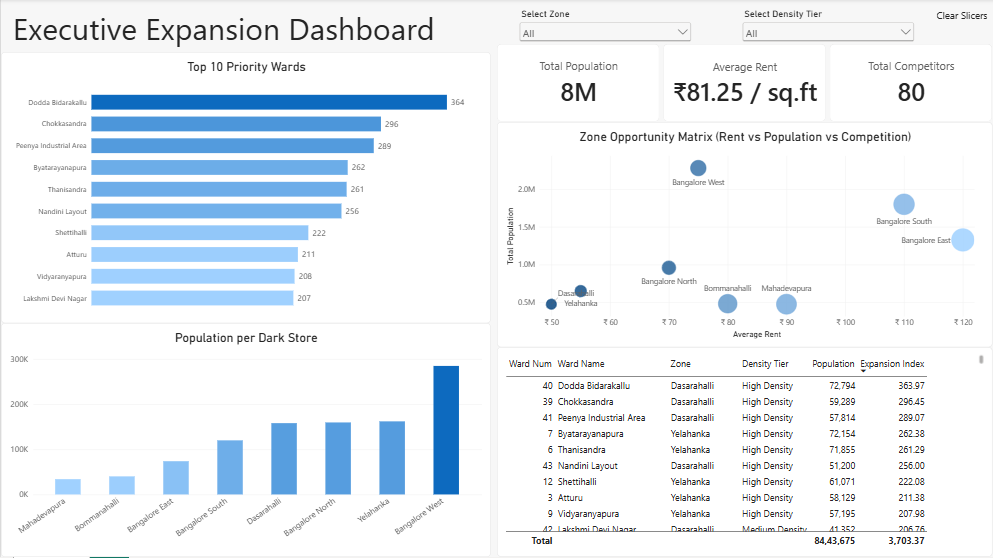

# Bengaluru Quick-Commerce Dark Store Expansion Strategy

An end-to-end geospatial market expansion and feasibility analytics project evaluating **198 BBMP wards across 8 administrative zones** in Bengaluru to identify optimal locations for quick-commerce dark stores. The analytical pipeline encompasses data wrangling and dimensional modeling in Python (Pandas), relational query execution in SQL (DuckDB), and interactive strategic reporting in Power BI.

---

## Dashboard Preview



---

## Project Overview & Key Findings

* **Catchment & Market Baseline:** Evaluated **8,443,675 total residents** across 198 BBMP wards and 8 zones, benchmarked against a city-wide average commercial rent of **₹81.25/sq.ft** and **80 incumbent competitor dark stores**.
* **Micro-Level Ward Priority (Margin Optimization):** Wards in the **Dasarahalli** zone dominate unit-level expansion feasibility due to high localized residential density paired with low commercial leasing rates (₹50/sq.ft) and minimal competition (3 stores). The top three priority wards are **Dodda Bidarakallu (Index: 363.97)**, **Chokkasandra (296.45)**, and **Peenya Industrial Area (289.07)**.
* **Macro-Level Territory Expansion (Volume Capture):** **Bangalore West** represents the most under-penetrated macro zone at **285,022.50 residents per dark store** (2,280,180 population served by only 8 stores at ₹75/sq.ft rent), offering substantial volume headroom for multi-store fleet deployment.
* **Saturation & Margin Traps:** **Mahadevapura** (33,897.36 residents/store across 14 competitors) and **Bangalore East** (73,728.28 residents/store, ₹120/sq.ft rent, 18 competitors) exhibit heavy market saturation and high OpEx overhead, flagging diminishing returns for new leases.
* **High-Density Low-Rent Hotspots:** Filtering for `'High Density'` wards situated in zones below the city-wide rent average isolates prime low-cost, high-demand clusters in **Yelahanka** (Byatarayanapura, Thanisandra, Shettihalli) and **Bangalore North** (Bagalakunte, Nagavara).

---

## Tech Stack & Data Flow

* **ETL & Dimensional Modeling:** Python (Jupyter Notebook, `Pandas`, `DuckDB`)
* **Database & Analytical SQL:** DuckDB (ANSI SQL via VS Code DuckDB Extension)
* **Data Modeling & Visualization:** Power BI Desktop (Star Schema, DAX `CALCULATE`, `CROSSFILTER`, `ALL`)

```text
[ Raw Input Files ]
  ├── data/raw/bengaluru_wards_2011.csv (198 BBMP wards)
  ├── data/raw/commercial_rent.csv (8 zone rent benchmarks)
  └── data/raw/competitor_density.csv (8 zone store counts)
              │
              ▼  (Python / Pandas — etl_pipeline.ipynb)
  ├── Administrative Ward-to-Zone Mapping (8 BBMP Zones)
  ├── Quantile Density Classification via pd.qcut() (Low / Medium / High)
  └── Normalized 3-Table Star Schema Export & DuckDB Ingestion
              │
              ▼
[ Processed Star Schema & DuckDB ]
  ├── data/processed/dim_geography.csv (198 rows)
  ├── data/processed/dim_zone.csv (8 rows)
  ├── data/processed/fact_ward_metrics.csv (198 rows)
  └── database/bengaluru_expansion.duckdb
              │
      ┌───────┴───────────────────────────┐
      ▼                                   ▼
[ SQL Analysis (DuckDB) ]         [ Power BI Dashboard ]
(4 Business Queries: CTEs,        (Single-page 16:9 Executive
 Window Functions, Subqueries)     Expansion Report)
```

---

## Data Pipeline & Star Schema Modeling (Python)

The raw census file (`bengaluru_wards_2011.csv`) contained ward-level demographics without administrative zone groupings, while commercial rent and competitor counts were aggregated at the zone level. The Jupyter Notebook (`etl_pipeline.ipynb`) cleans, maps, and normalizes the data into a 3-table Star Schema.

### Core Processing Steps:

**1. Load Raw Datasets & Standardize Zone Keys:**
```python
import pandas as pd
import duckdb

pop = pd.read_csv("data/raw/bengaluru_wards_2011.csv")
rent = pd.read_csv("data/raw/commercial_rent.csv")
comp = pd.read_csv("data/raw/competitor_density.csv")

# Merge zone-level benchmarks and clean string formatting for exact relational joins
dim_zone = rent.merge(comp[['Zone', 'Competitor_Count']], on='Zone', how='left')
dim_zone['Zone'] = dim_zone['Zone'].str.split('(').str[0].str.strip()
```

**2. Map BBMP Wards to Administrative Zones & Classify Density Tiers:**
```python
# Map all 198 wards to their respective BBMP administrative zones
pop['Zone'] = pop['Ward Num'].map(ward_to_zone)

# Categorize wards into equal-sized tertiles based on population distribution
pop['Density Tier'] = pd.qcut(
    pop['Population'],
    q=3,
    labels=['Low Density', 'Medium Density', 'High Density']
)
```

**3. Export Star Schema Tables & Load into DuckDB:**
```python
# Separate into dimension and fact tables
dim_geo = pop[['Ward Num', 'Ward Name', 'Zone', 'Assembly constituency']].copy()
fact_ward_metrics = pop[['Ward Num', 'Zone', 'Population', 'Density Tier']].copy()

dim_zone.to_csv("data/processed/dim_zone.csv", index=False)
dim_geo.to_csv("data/processed/dim_geography.csv", index=False)
fact_ward_metrics.to_csv("data/processed/fact_ward_metrics.csv", index=False)

# Ingest into persistent DuckDB database
con = duckdb.connect("database/bengaluru_expansion.duckdb")
con.execute("CREATE OR REPLACE TABLE dim_zone AS SELECT * FROM read_csv_auto('data/processed/dim_zone.csv');")
con.execute("CREATE OR REPLACE TABLE dim_geography AS SELECT * FROM read_csv_auto('data/processed/dim_geography.csv');")
con.execute("CREATE OR REPLACE TABLE fact_ward_metrics AS SELECT * FROM read_csv_auto('data/processed/fact_ward_metrics.csv');")
con.execute("CHECKPOINT;")
con.close()
```

---

## Analytical SQL Queries (DuckDB)

Analytical queries executed against `database/bengaluru_expansion.duckdb` in `analysis_queries.sql`:

### Query 1: City-Wide Opportunity Ranking (CTE + `DENSE_RANK`)
Calculates an **Expansion Index** balancing catchment population against commercial rent and competitor presence, ranking all 198 wards city-wide:
```sql
WITH ward_scoring AS (
    SELECT
        f."Ward Num",
        g."Ward Name",
        f.Zone,
        f."Density Tier",
        f.Population,
        ROUND(
            f.Population * 1.0 / (z.Avg_Commercial_Rent_Per_SqFt * (1 + z.Competitor_Count)), 
            2
        )::DECIMAL(10, 2) AS expansion_index
    FROM fact_ward_metrics AS f
    LEFT JOIN dim_geography AS g
        ON f."Ward Num" = g."Ward Num"
    LEFT JOIN dim_zone AS z
        ON f.Zone = z.Zone
)
SELECT
    *,
    DENSE_RANK() OVER (ORDER BY expansion_index DESC) AS opportunity_rank
FROM ward_scoring
ORDER BY opportunity_rank ASC;
```

### Query 2: Top 2 Expansion Wards per Zone (`ROW_NUMBER` + `PARTITION BY`)
Partitions wards by administrative zone to isolate the top two highest-feasibility locations in each territory:
```sql
WITH ward_scoring AS (
    SELECT
        f."Ward Num",
        g."Ward Name",
        f.Zone,
        f."Density Tier",
        f.Population,
        ROUND(
            f.Population * 1.0 / (z.Avg_Commercial_Rent_Per_SqFt * (1 + z.Competitor_Count)), 
            2
        )::DECIMAL(10, 2) AS expansion_index
    FROM fact_ward_metrics AS f
    LEFT JOIN dim_geography AS g
        ON f."Ward Num" = g."Ward Num"
    LEFT JOIN dim_zone AS z
        ON f.Zone = z.Zone
),
zone_ranked_wards AS (
    SELECT
        *,
        ROW_NUMBER() OVER (PARTITION BY Zone ORDER BY expansion_index DESC) AS zone_rank
    FROM ward_scoring
)
SELECT
    Zone,
    zone_rank,
    "Ward Num",
    "Ward Name",
    "Density Tier",
    Population,
    expansion_index
FROM zone_ranked_wards
WHERE zone_rank <= 2
ORDER BY Zone, zone_rank;
```

### Query 3: Zone Market Saturation & Customer-to-Store Ratio (Grain-Safe Aggregation)
Aggregates ward population to zone level using `MAX()` on zone-level dimension attributes to avoid 1-to-many join fan-out:
```sql
SELECT
    f.Zone,
    SUM(f.Population) AS total_population,
    MAX(z.Competitor_Count) AS total_dark_stores,
    MAX(z.Avg_Commercial_Rent_Per_SqFt) AS average_rent,
    ROUND(
        SUM(f.Population) * 1.0 / NULLIF(MAX(z.Competitor_Count), 0), 
        2
    )::DECIMAL(10, 2) AS population_per_store
FROM fact_ward_metrics AS f
LEFT JOIN dim_zone AS z
    ON f.Zone = z.Zone
GROUP BY f.Zone
ORDER BY population_per_store DESC;
```

### Query 4: High-Density, Below-Average Rent Hotspot Filtering (Scalar Subquery)
Isolates `'High Density'` wards located in zones where commercial rent falls below the city-wide mean:
```sql
SELECT
    f."Ward Num",
    g."Ward Name",
    f.Zone,
    f."Density Tier",
    f.Population,
    z.Avg_Commercial_Rent_Per_SqFt AS zone_rent,
    ROUND((SELECT AVG(Avg_Commercial_Rent_Per_SqFt) FROM dim_zone), 2) AS city_avg_rent
FROM fact_ward_metrics AS f
LEFT JOIN dim_geography AS g
    ON f."Ward Num" = g."Ward Num"
LEFT JOIN dim_zone AS z
    ON f.Zone = z.Zone
WHERE
    f."Density Tier" = 'High Density'
    AND z.Avg_Commercial_Rent_Per_SqFt < (
        SELECT AVG(Avg_Commercial_Rent_Per_SqFt) FROM dim_zone
    )
ORDER BY f.Population DESC;
```

---

## Power BI Executive Dashboard

The Power BI report (`dashboard/expansion_strategy.pbix`) is modeled as a Star Schema (`dim_geography` 1:* `fact_ward_metrics` *:1 `dim_zone`) on a single 16:9 canvas.

### 1. Core DAX Measures

* **Catchment Volume & Market Benchmarks:**
  ```dax
  Total Population = SUM(fact_ward_metrics[Population])
  Total Competitors = SUM(dim_zone[Competitor_Count])
  Average Rent = AVERAGE(dim_zone[Avg_Commercial_Rent_Per_SqFt])
  ```

* **Context-Aware Expansion Index (`CROSSFILTER`):** Uses temporary bi-directional filtering so ward-level visuals (`dim_geography`) accurately retrieve parent zone rent and competitor counts (`dim_zone`) across the fact table:
  ```dax
  Expansion Index = 
  VAR CurrentRent = 
      CALCULATE(
          MAX(dim_zone[Avg_Commercial_Rent_Per_SqFt]),
          CROSSFILTER(fact_ward_metrics[Zone], dim_zone[Zone], Both)
      )
  VAR CurrentCompetitors = 
      CALCULATE(
          MAX(dim_zone[Competitor_Count]),
          CROSSFILTER(fact_ward_metrics[Zone], dim_zone[Zone], Both)
      )
  VAR FrictionScore = CurrentRent * (CurrentCompetitors + 1)
  RETURN
      ROUND(DIVIDE([Total Population], FrictionScore), 2)
  ```

* **Macro Saturation Ratio (`ALL`):** Removes ward-level density tier filters so customer-to-store ratios reflect true zone-wide catchment:
  ```dax
  Customers per Dark Store = 
  VAR ZoneTotalPop = 
      CALCULATE(
          [Total Population],
          ALL(fact_ward_metrics[Density Tier])
      )
  VAR Stores = [Total Competitors]
  RETURN
      ROUND(DIVIDE(ZoneTotalPop, Stores), 0)
  ```

### 2. Report Visualizations
1. **Executive KPI Scorecards:** Three top-right cards displaying **Total Population (8M)**, **Average Rent (₹81.25 / sq.ft)**, and **Total Competitors (80)**.
2. **Top 10 Priority Wards:** Gradient-formatted horizontal bar chart ranking the highest-scoring expansion wards, led by Dodda Bidarakallu (364), Chokkasandra (296), and Peenya Industrial Area (289).
3. **Zone Opportunity Matrix (Scatter Plot):** Four-quadrant bubble chart plotting Average Rent (X-axis) against Total Population (Y-axis) sized by Competitor Count, highlighting **Bangalore West** as the optimal high-population, moderate-rent quadrant.
4. **Population per Dark Store:** Column chart comparing customer-to-store saturation across all 8 zones, contrasting under-served **Bangalore West (~285K/store)** against saturated **Mahadevapura (~34K/store)**.
5. **Ward Opportunity Ledger:** Sortable, filterable detail table displaying `Ward Num`, `Ward Name`, `Zone`, `Density Tier`, `Population`, and `Expansion Index`.
6. **Global Slicers:** Interactive dropdown slicers for **Select Zone** and **Select Density Tier** with a quick-reset **Clear Slicers** button.

---

## Strategic Expansion Recommendations

1. **Immediate Phase 1 Rollout (High Unit Margin):** Prioritize initial dark store leases in **Dasarahalli**—specifically **Dodda Bidarakallu**, **Chokkasandra**, and **Peenya Industrial Area**—where high residential density intersects with low commercial rent (₹50/sq.ft) and minimal incumbent competition (3 stores).
2. **Phase 2 Multi-Store Scaling (Volume Capture):** Deploy multi-store clusters across **Bangalore West**, which carries the highest unmet customer ratio (**285,023 residents per store**) at sustainable leasing rates (₹75/sq.ft).
3. **Capital Preservation in Saturated Zones:** Defer aggressive dark store expansion in **Mahadevapura** (33,897 residents/store) and **Bangalore East** (₹120/sq.ft rent, 18 competitors), focusing instead on micro-fulfillment optimization of existing facilities.

---

## Setup & Reproduction

1. **Clone the Repository:**
   ```bash
   git clone https://github.com/Harsh-Devv/bengaluru-dark-store-expansion.git
   cd bengaluru-dark-store-expansion
   ```

2. **Run the Python ETL Pipeline:**
   ```bash
   pip install pandas duckdb
   jupyter notebook etl_pipeline.ipynb
   ```

3. **Execute Analytical SQL Queries:**
   Open `analysis_queries.sql` in VS Code with the DuckDB extension attached to `database/bengaluru_expansion.duckdb`, or run via DuckDB CLI.

4. **Explore the Power BI Dashboard:**
   Open `dashboard/expansion_strategy.pbix` in Power BI Desktop.